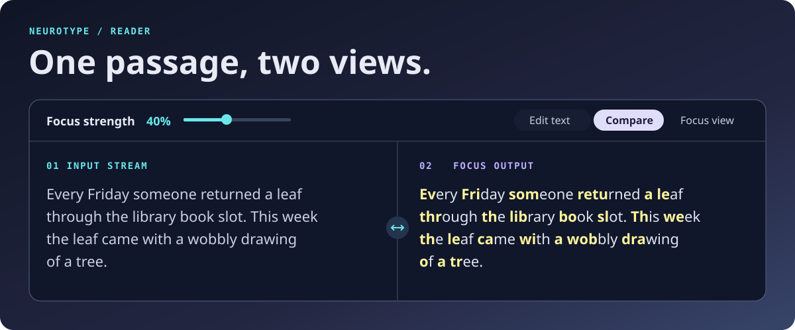
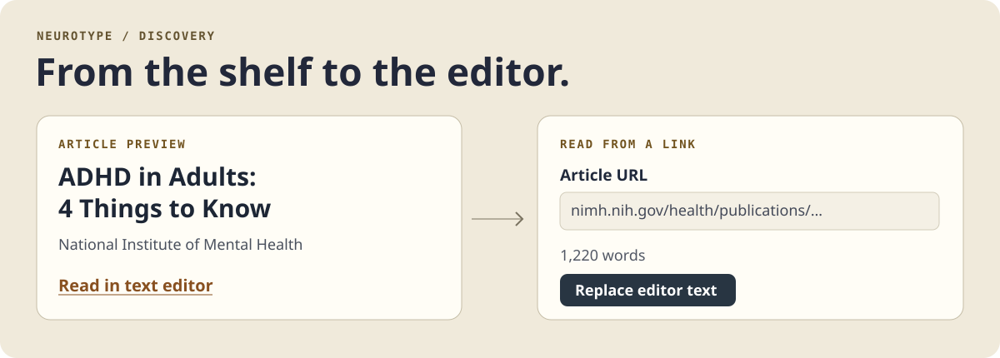

# Neurotype Reader

Neurotype Reader is a bionic reading app that bolds the beginning of each word. Paste a passage or import an article, then adjust the emphasis while comparing both versions side by side. At 40% focus strength, “Reading rhythm” becomes **Rea**ding **rhy**thm.

[Try the live app](https://neurotype-reader.urbansafariwear.chatgpt.site/) · [Built by Ayla Basha](https://www.linkedin.com/in/aylabasha/)



## Features

- **Adjustable reader.** Change emphasis, text size, and color contrast as you read. Drag the divider or use the arrow keys to compare a passage, then switch to a full-width focus view.
- **Article import.** Open a supported URL or select an article from the research shelf. Preview the source and word count before replacing your draft. Recent passages stay on your device.
- **Extractive summaries.** Pull up to four key sentences from a passage in their original order. The summarizer runs in the browser without an AI service.
- **Focus audio.** Build a queue from curated tracks or search by mood, genre, and activity. Signed-in readers can save playlists and favorites.



## Technology

| Technology | Role in the app |
| --- | --- |
| React 19 and TypeScript | The [editor](app/page.tsx) calculates each bold prefix from Unicode letters and numbers, preserving the passage’s spacing and punctuation. |
| Vite, Vinext, and Cloudflare Workers | Vinext builds the App Router project for Workers. The [article importer](app/api/read-link/importer.ts) checks each redirect against supported publishers and extracts readable text with `node-html-parser`. |
| Cloudflare D1 and Drizzle ORM | D1 stores account preferences, music collections, and provider request counts. Drizzle defines their schemas and SQL migrations. |
| YouTube Data API v3 | Signed-in readers can search for embeddable videos. The [music search](app/api/youtube-search/provider.ts) falls back to curated channel feeds when the service or quota is unavailable. |

<details>
<summary><strong>Local development and tests</strong></summary>

Use Node.js 24 on Linux with Bash, GNU `timeout`, `flock`, `sha256sum`, and `curl`. Run these commands from a fresh clone.

```sh
npm run install:ci
npm run build

# Initialize local D1 once. The home page uses it for request limits.
(
  set -e
  for migration in drizzle/*.sql; do
    npx wrangler d1 execute DB --local --config dist/server/wrangler.json \
      --persist-to .wrangler/state --file "$migration"
  done
) && npm run dev
```

Open the URL printed by Vite. The editor works without API keys. Optional music search, research answers, and email settings are listed in [.env.example](.env.example).

```sh
npm test
node --test tests/*.test.mjs
npx wrangler types ./worker-configuration.d.ts --config dist/server/wrangler.json
npx tsc --noEmit --incremental false
```

</details>
